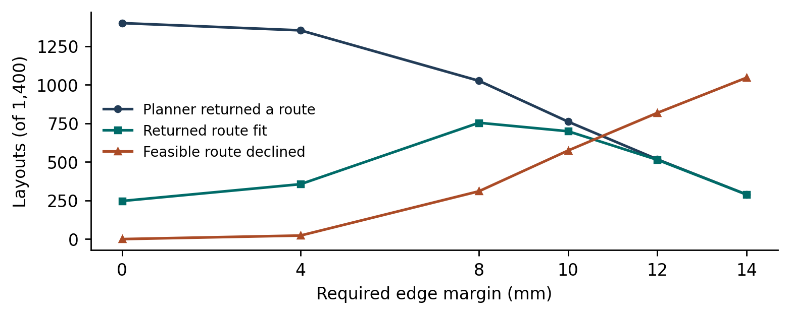

# Choosing a route through uncertain foothold edges

On 1,400 bottleneck maps, two planners accepted the same 1,026 layouts at an 8 mm edge margin. The travel-minimizing planner returned 754 routes that fit the true terrain. Maximizing the smallest clearance along the route returned 910. The extra 156 valid routes came from changing the path inside the accepted set. [Travel criterion](results.csv?plain=1#L104) · [Widest-path criterion](results.csv?plain=1#L109) · [Clearance propagation](run.py#L59)



The planner sees six rows of uncertain patches. A separate evaluation uses their actual boundaries. Each foot has a half-width of 23 mm. Within the declared map model, an 8 mm center shift and a 6 mm inward edge loss can combine, so a 14 mm margin covers both. On the bottleneck maps this protected all 289 accepted routes, while rejecting 1,046 layouts for which a feasible route existed on the finite graph. Increasing the map errors by a factor of 1.75 produced 130 edge crossings among those same 289 routes.

These counts describe geometric footprint and reach. They leave whole-body balance and physical execution open. [Planning results](results.csv) · [Methods](manuscript.md) · [Paper PDF](manuscript.pdf)

## A source foot-plant label and a displacement budget

The companion test runs the released NVIDIA SOMA Retargeter v0.2.0 foot-plant detector on 18 synthetic source trajectories using the CPU. The detector accepted 12. At 60 mm/s, three different durations received the same confidence of 0.69 while lateral excursion grew from 15 to 30 to 60 mm. A contact label alone leaves that displacement unspecified. Applying an excursion to the route margin would require measuring the corrected robot foot in the terrain coordinate frame. [Fixture results](soma_results.csv) · [Archived upstream license](soma_modules/LICENSE) · [Upstream detector](https://github.com/NVIDIA/soma-retargeter/blob/1733b820f3cdf6f74bbc81a10bda3201b38c7bcf/soma_retargeter/pipelines/plant_subsegment_detector.py)

## Reproduce

From the repository root with Python 3.11, install the [main requirements](requirements.txt), run the simulator and verify the saved summaries.

```shell
python -m pip install -r requirements.txt
python run.py
python verify.py
```

[run.py](run.py) regenerates 120 planning conditions. [verify.py](verify.py) reads the CSVs independently with the standard library. It checks the complete grid, route counts, the 14 mm bound and the 18 SOMA fixtures. You can run it against the archived files before installing dependencies.

To repeat the source contact detector, install the [SOMA requirements](requirements-soma.txt). The CPU Warp kernel creates a local cache on its first execution.

```shell
python -m pip install -r requirements-soma.txt
python soma_check.py
python verify.py
```

To redraw the figure from the planning results, install the [plotting requirements](requirements-plot.txt) and run [make_figure.py](make_figure.py).

```shell
python -m pip install -r requirements-plot.txt
python make_figure.py
```

Run `python run.py --timings` to refresh [the optional timing sample](timings.csv). It measures a single corrected-patch map update and replanning call for 160 layouts. Machine-dependent solve times exclude perception, communication and physical execution.

Maintained by Vedant Thaker.
