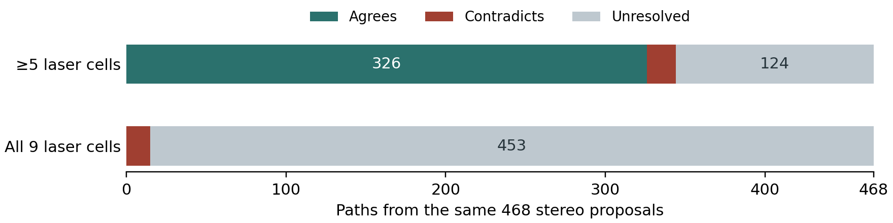

# How much of a candidate foothold does a second terrain map observe?

Vedant Thaker  
Independent Researcher, Jeffersonville, Indiana, USA  
vedant.thaker1602@gmail.com

Terrain mapping study

### Abstract

A patch of ground can appear level when a robot observes only part of it. Thirty lidar scans from an ANYmal C traverse of the Louisville Mega Cavern were compared with the independently surveyed course under the published scan poses. Among 10,200 candidate 30-cm square patches, the robot map accepted 190 under a five-of-nine-cell coverage rule and a 10-cm height-range limit. Under the same rule, the survey supported 103, contradicted 14 and left 73 unresolved. Requiring all nine survey cells on those same patches changed the counts to 12, one and 177. A separate roadway-stereo comparison showed a similar loss of corroboration for complete paths. The observations quantify which geometric decisions the second map can test. They contain no executed foot contacts from which to estimate slip or stepping risk.

## An underground quadruped traverse and a survey

A spot with five observed height cells can pass a roughness check even when the other four cells contain a ledge. Whether another sensor also accepts that spot depends on what the second sensor sees. We first examined floor patches in real underground terrain, then asked how missing observations accumulate along 15-step paths in a separate stereo benchmark. The two comparisons have different sensors, denominators and spatial layouts; their counts are reported separately.

The CERBERUS archive contains onboard VLP-16 measurements and supplied lidar poses from an ANYmal C in the DARPA Subterranean Challenge finals [5,7,8]. The organizer released a million-point downsampled course survey in the DARPA frame [6]. We analyzed 30 approximately 41-second-spaced full rotations from the first listed robot. They span 20.0 minutes in one mission. Thirty of 32 target bag segments spanning the middle 90% of the available pose timestamps were obtained, in chronological order; no segment was selected by its geometric outcome. Each scan time matches a supplied pose. The course survey is a separate acquisition, but the data providers estimated the poses by registering onboard scans to that survey. Agreement is therefore conditional on that registration. It cannot validate autonomous localization drift.

Scan decoding uses the nominal VLP-16 vertical angles, 2-mm range increment and firing-time azimuth interpolation [9]. We applied one supplied pose per rotation without motion deskew. Around the laser origin we constructed a gravity-level 0.10-m grid oriented to the horizontally projected laser x-axis. To restrict the comparison to nearby floor candidates, each map used returns 0.20–1.40 m below the sensor. The scan was range-filtered at 0.75–8 m. One or more observations in a cell defined its median height. In this narrow band, elevated obstacles and swing-foot collisions can go unseen. This filter defines a measurement window, not traversability.

At each scan we tested the same 340 nonoverlapping 3 × 3 cell tiles with centers 2.5–4.0 m from the sensor. A tile passes when at least k cells are observed and the observed heights span at most 0.10 m. For each passing robot tile the survey either passes the same height limit, contradicts it, or has too few observed cells to judge. Repeated views from one mission can revisit the same floor. These are scan–tile counts, not independent terrain samples.

| Robot cells | Survey cells | Robot accepted | Survey supports | Contradicts | Unresolved |
| --- | --- | --- | --- | --- | --- |
| 3 | 3 | 584 | 425 | 87 | 72 |
| 5 | 5 | 190 | 103 | 14 | 73 |
| 5 | 9 | 190 | 12 | 1 | 177 |
| 7 | 7 | 14 | 3 | 1 | 10 |
| 9 | 9 | 0 | 0 | 0 | 0 |
Table 1. Subterranean floor-patch outcomes. The middle two rows score identical robot-selected tiles. Each row starts from 10,200 candidate tiles across 30 scans. Observed-cell counts of five and seven are exploratory thresholds.

Across 9,262 shared cell observations in the complete 9 × 9 m windows, the median of 30 scan-specific median absolute height differences was 39.6 mm (interquartile range 33.2–66.2 mm). A cell-wise error summary and a footprint decision use different information. In particular, demanding complete reference coverage removes most opportunities to observe either agreement or disagreement.

## Roadway scenes and route-length coverage

The secondary comparison uses KITTI Stereo 2012 roadway images and their registered laser disparities [1]. A car collected these data. A fixed-heading path of candidate landings was overlaid offline to study cumulative coverage loss. The lanes supply neither a quadruped trajectory nor evidence for walking safety.

## Constructing the stereo and laser grids

The input is the complete public training split of 194 static scenes [1]. OpenCV StereoSGBM, in three-way mode, estimates disparity from the rectified grayscale pair [2]. Its fixed settings use 96 disparity levels, a 5-pixel matching block and a uniqueness ratio of 10. The reference comes from KITTI’s non-occluded disparity product constructed from registered laser sweeps. It contains gaps after projection and manual exclusion of ambiguous regions. Stereo and laser share the calibration and the coordinate frame; these residuals therefore omit common frame error.

Each disparity source is back-projected with the supplied rectified camera matrices. A robust plane fit to central stereo points in a nominal road-height band defines the origin and up direction. No laser value enters the plane estimate or route selection. Points in front of the camera are rasterized at 0.10 m resolution over a 9 × 9 m region beginning 6 m ahead. A cell receives the median height of its points if at least two contribute. One scene (000030) failed the frame test, leaving 193 scenes and 965 of the 970 possible lane queries. The two maps had 897,930 common observed cells. Across scenes the median of the scene-wise median absolute height differences was 14.0 mm, with interquartile range 12.1–16.2 mm. Such an error summary gives no guarantee that the chosen steps agree.

A footprint spans 3 × 3 cells. The observed heights must lie within 0.40 m above or below the estimated ground plane, and their range must be at most 0.06, 0.10 or 0.15 m. We vary the minimum observed count between five, seven and nine cells. Missing heights are never filled. With a partial footprint, a passing decision refers only to the available cells. The five- and seven-cell rules were examined after the complete-cell rule produced zero stereo routes. This is an exploratory benchmark.

## Local adaptation and look-ahead on a common graph

Each scene supplies five equally spaced lane centerlines. A query requests 15 alternating foot placements spaced 0.40 m forward, spanning 5.60 m. The nominal left/right offsets are −0.20 m and +0.20 m. On intermediate rows, 17 candidate lane offsets span ±0.80 m at 0.10 m spacing. Consecutive lane offsets can change by at most 0.20 m, in addition to the nominal alternation. The first and last offsets are fixed at zero, giving up to 223 nodes per query. The model fixes heading and does not represent body or swing-foot collisions.

The local rule chooses the reachable admissible site closest to the nominal foot position. Villarreal et al. used this principle after applying their robot-specific reach, terrain and collision checks [3]. The global comparator searches a finite set of alternating footstep actions, following the planning structure of Chestnutt et al. [4]. Here all edges advance one row, so dynamic programming exactly minimizes the sum of absolute lane offset and absolute change in offset, in grid cells. The code and action set are specific to this replay. The published ASIMO system used A* with its own state-dependent actions and controller.

For each rule, the stereo map alone supplies eligible sites. The global planner can additionally exclude centers lying within 0.10 or 0.20 m of a failed or insufficiently observed center, using Euclidean grid-center distance. The laser reference then evaluates the selected route at the same 15 locations. Agreement requires all to qualify. Contradiction requires one or more observable landings violating the height rules. Other accepted paths remain unresolved. A separate laser-only graph search records whether any qualifying route exists in that lane. An unresolved selected path can coexist with another fully assessable path.

## Clearance trades confirmed coverage for fewer contradictions

At the five-cell, 0.10 m height-range rule, the local selector found 429 paths; global search found 468. Of the 626 lanes admitting a laser-reference route, 250 were rejected by the local selector and 219 by the global search. Adding 0.10 m of clearance to that search rejected 386 of the 626. It removed 15 observed contradictions from the aggregate count, while the number of reference-supported paths fell by 127. The lane, footprint and sensor settings must accompany either comparison.

The measured contradictions are a lower bound on contradictions among all proposed paths. With 124 unresolved outcomes, the no-margin graph’s potential count ranges from 18 to 142 of 468 if the missing evidence could resolve either way. On the same interpretation, 0.10 m clearance gives 3 to 72 of 271. These are identification bounds under the selected footprint rule. No independence assumption about successive landings or overlapping lanes is needed.

| Stereo policy | Proposed | Agree | Disagree | Unknown | Feasible lanes rejected |
| --- | --- | --- | --- | --- | --- |
| Local nearest | 429 | 306 | 14 | 109 | 250 |
| Graph | 468 | 326 | 18 | 124 | 219 |
| Graph + 0.10 m | 271 | 199 | 3 | 69 | 386 |
| Graph + 0.20 m | 130 | 98 | 2 | 30 | 507 |
Table 2. Five occupied cells required per footprint in each map, 0.10 m height-range limit. Each row covers the same 965 lane queries. The final column counts stereo rejections among 626 laser-reference-feasible lanes.

## What changes when the reference must see all nine cells?

Keeping the original 468 paths fixed while demanding a complete nine-cell laser footprint at every landing leaves zero fully corroborated routes. Fifteen contain at least one completely observed violation. The remaining 453 are unresolved. The analogous test on the 271 paths with a 0.10 m margin finds one contradicted and 270 unresolved. Five sampled cells can corroborate an observed height range, while a hazard on one of the other four cells could go undetected.

Changing both maps to seven cells cut proposed paths from 468 to 188. Changing both to nine eliminated them despite 23 laser-feasible lane queries. Varying the height-range limit while retaining the five-cell rule had a smaller effect on proposed routes (Table 3). The result depends on the chosen 0.10 m grid, coverage requirement and route length. Counting the five lanes per scene as independent replicates would understate their shared scene and calibration effects.

| Cells required | Height range (m) | Proposed | Agree | Disagree | Unknown | Laser feasible |
| --- | --- | --- | --- | --- | --- | --- |
| 5 | 0.06 | 445 | 307 | 18 | 120 | 612 |
| 5 | 0.10 | 468 | 326 | 18 | 124 | 626 |
| 5 | 0.15 | 483 | 341 | 11 | 131 | 642 |
| 7 | 0.10 | 188 | 39 | 10 | 139 | 317 |
| 9 | 0.10 | 0 | 0 | 0 | 0 | 23 |
Table 3. Unmargined graph search on the same 965 lanes. Each row applies the indicated cell and height rules to both sensors.

## Foot-placement uncertainty and transfer

Villarreal et al. report 3 cm uncertainty around the nominal foothold due to trunk-state estimation, followed by a separate observation of 2.5 cm of short-term map drift after approximately 2 m of travel [3, Sec. IV-C(c), journal p. 2143]. Both figures appear on page 5 of the authors’ nine-page PDF, which includes a cover. Section IV-A also describes roughly 3 cm average landing-prediction error in preliminary flat-terrain trotting. These measurements describe their robot and procedure. We used neither to set the present grid margin. The grid erosion here removes candidates close to an observed failure or coverage boundary. It does not bound drift, and a single-frame comparison cannot reproduce drift accumulation.

The two maps agree on some partial footprints and explicitly disagree on others. Their missing observations sharply limit what can be concluded about a whole path, even when typical height residuals are small. A field decision requires tracked robot foot poses, an independently surveyed or contact-labeled support surface, and repeated traversals that include rejected terrain. The cave comparison supplies onboard sensing and a surveyed surface, but map-assisted registration, a single mission, a low-density reference and the absence of contact labels still prevent a probability-of-failure estimate.

## Data and code availability

The KITTI Stereo 2012 data and calibration are available from https://www.cvlibs.net/datasets/kitti/eval_stereo_flow.php?benchmark=stereo . The accompanying supplement gives exact input hashes, software versions, route classifications, summary tables and reproduction commands. The KITTI-derived tables retain CC BY-NC-SA 3.0 attribution and terms. The primary test uses ETH’s CERBERUS data release [5] and the organizer’s surveyed course [6]. Only aggregate outcomes, the list of selected scan identifiers and verification code are distributed here. Underlying sensor records and maps remain with their providers. KITTI’s noncommercial/share-alike terms apply to the relevant derived roadway materials. A publication requiring conflicting terms for that material would need permission or its removal.

[Study files, software and source records](https://github.com/VEDANT1602/foothold-margin-planning/tree/main/study)

## Author and disclosures

Vedant Thaker is the sole author and set the research question. OpenAI Codex assisted with decoding the onboard lidar, comparing scan and survey measurements, processing the roadway stereo data, implementing the planning comparisons and drafting the analysis.

This research received no specific grant from any funding agency in the public, commercial, or not-for-profit sectors. The author declares no competing interests.

## References

[1] A. Geiger, P. Lenz and R. Urtasun. Are we ready for autonomous driving? The KITTI Vision Benchmark Suite. IEEE Conference on Computer Vision and Pattern Recognition, 3354–3361, 2012. <https://doi.org/10.1109/CVPR.2012.6248074>

[2] OpenCV. StereoSGBM class reference, version 4.12.0. Disparity matching API and implementation settings. <https://docs.opencv.org/4.12.0/d2/d85/classcv_1_1StereoSGBM.html>

[3] O. Villarreal, V. Barasuol, M. Camurri, L. Franceschi, M. Focchi, M. Pontil, D. G. Caldwell and C. Semini. Fast and continuous foothold adaptation for dynamic locomotion through CNNs. IEEE Robotics and Automation Letters 4(2), 2140–2147, 2019. <https://doi.org/10.1109/LRA.2019.2899434>

[4] J. Chestnutt, M. Lau, G. Cheung, J. Kuffner, J. Hodgins and T. Kanade. Footstep planning for the Honda ASIMO humanoid. IEEE International Conference on Robotics and Automation, 629–634, 2005. <https://publications.ri.cmu.edu/footstep-planning-for-the-honda-asimo-humanoid>

[5] M. Tranzatto, L. Bernreiter and S. M. K. Khattak. CERBERUS DARPA Subterranean Challenge – Final Event. ETH Zürich Research Collection, 2022. <https://doi.org/10.3929/ethz-b-000552248>

[6] DARPA Subterranean Challenge. Systems Finals Ground Truth. Downsampled course survey in the DARPA frame, repository version 8276a16. <https://github.com/subtchallenge/systems_finals_ground_truth/tree/8276a16155eddf966e4458e40054bc53a31c8ac5>

[7] M. Tranzatto et al. CERBERUS in the DARPA Subterranean Challenge. Science Robotics 7, eabp9742 (2022). <https://doi.org/10.1126/scirobotics.abp9742>

[8] M. Tranzatto et al. Team CERBERUS wins the DARPA Subterranean Challenge: technical overview and lessons learned. Field Robotics 4 (2024). <https://doi.org/10.55417/fr.2024009>

[9] Velodyne Lidar. VLP-16 User Manual, revision F. Laser channel positions and azimuth interpolation for packet decoding. <https://data.ouster.io/downloads/velodyne/user-manual/vlp-16-user-manual-revf.pdf>
