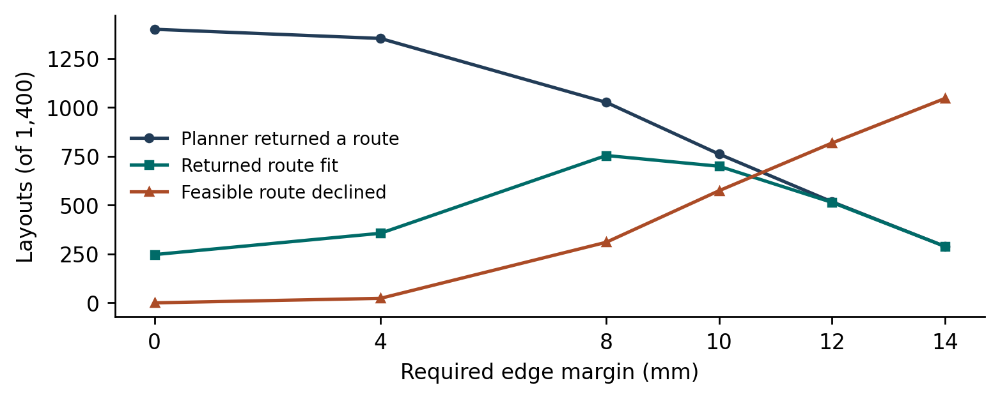

# Route coverage under bounded and probabilistic foothold-edge errors

**Vedant Thaker**  
Independent Researcher, Jeffersonville, Indiana, United States  
Correspondence: vthaker1@asu.edu  
21 November 2026

## Abstract

A foothold planner can protect accepted routes by rejecting terrain that a different route could traverse. This study measures that cost on a six-row lateral graph. Under a bounded map-error model, a 14 mm margin certified 289 of 1,400 bottleneck layouts and rejected 1,046 of the 1,335 layouts with a feasible route. A separate comparison converted a published RGB-D edge-noise measurement into range-dependent margins with a 5% route failure budget. With centered Gaussian edge errors at that measured scale, the chance-constrained travel planner accepted 1,170 routes, of which 1,167 fit. A fixed 14 mm rule accepted 289 and all fit. Adding an unmodeled shared 25 mm displacement made all 1,170 chance-planned routes invalid. Explicitly allowing for that displacement left no bottleneck route eligible. The two models distinguish an assumed bound from a probability under a specified error law. The sensor experiment supplies edge precision; a measured terrain-frame registration error is still needed for a deployment claim.

## The denominator for a foothold decision

A footstep plan may be invalid even when the map contains a valid route. Conversely, a planner that rarely accepts a map can place every accepted step inside its patch and still decline most usable terrain. These cases can be counted separately when the evaluator knows the true boundaries. This study uses a modest graph so that the rejection of feasible layouts can be measured directly.

Deits and Tedrake optimize placements over convex terrain regions [1]. Tonneau and colleagues’ SL1M handles combinatorial surface selection with reachability and quasi-static constraints [2]. Grandia and colleagues infer foothold constraints from perception for model-predictive control [3]. Here the decision precedes dynamics. It asks whether all six prescribed lateral placements fit, whether any six-placement route could fit on the same graph, and how many layouts a protective cutoff excludes.

## Layout generator and route objectives

Each layout has six ordered rows and two patches per row. A row-wide center offset is uniform in [−26, 26] mm. Lane offsets are −36 and +36 mm, with independent jitter uniform in [−9, 9] mm per patch. Perceived half-widths are uniform in [39, 60] mm, except on bottleneck rows three and five where they are uniform in [25, 42] mm. A foot half-width is 23 mm. Each patch supplies its center and two offsets equal to ±0.65 times the residual half-width after allowing for the foot. This gives six candidates per row. Reach is at most 56 mm per lateral move, starting at zero. Forward order is fixed.

For candidate x on the perceived interval [l,r], clearance is min(x−l,r−x) − 23 mm. A travel-minimizing route must clear margin m at all six positions. Its cost is the sum of lateral move lengths plus 0.25 times the sum of absolute candidate coordinates. The widest route first maximizes its minimum clearance and breaks ties with this cost. At a common cutoff both objectives admit the same layouts, since a feasible path at m exists exactly when the largest attainable minimum clearance is at least m. Dynamic programming selects each route.

The evaluator shifts each patch laterally by up to 8 mm in either direction and moves each edge inward by an additional 0–6 mm. These quantities are uniform over their ranges. The signed center shift is either shared over the map or drawn independently per patch. Candidate centers retain their commanded world positions. A second dynamic-programming pass tests whether any valid route exists on the same discrete graph under the true boundaries. Independent exhaustive enumeration checks two layouts per split, error scale and shift-correlation setting.

## A bound on lateral footprint containment

Each individual edge can move inward by at most 8 + 6 = 14 mm. Thus m = 14 mm leaves at least zero true clearance at every accepted step, even under fully correlated errors. Scaling both error ranges by s gives the sufficient bound 14s mm. If actual foot-center tracking error can also move a footprint by at most d mm measured in that terrain frame, the sufficient margin becomes 14s + d. The inequality addresses the assigned patch’s lateral boundaries only.

The primary study uses 600 wide calibration layouts (seed 1708), 1,400 wide test layouts (8508) and 1,400 bottleneck test layouts (9508). Multiple objectives, margins and error scales reuse each layout. The unit for comparing objectives is one complete layout. The tabulated counts are observed under these generator settings.

Figure 1. Outcomes for the travel-minimizing planner across all six primary margins on 1,400 bottleneck layouts, original independent-shift error model. Returned and valid counts can separate before the certified margin is reached.

## Coverage and paired validity at a fixed cutoff

Table 1 gives independent patch shifts at the original error scale. Of 1,400 bottleneck layouts, 1,335 have a feasible graph route. At 8 mm, both planners admit 1,026 maps. On 162, only the widest route was valid. On six, only the travel route was valid. The net gain was 156 routes, or 11.14 percentage points across all 1,400 layouts (approximate pointwise 95% Monte Carlo interval 9.42–12.86). The interval uses the standard error of paired layout differences. The same net gain is 15.20 percentage points within the accepted subset.

At 14 mm, 289 plans fit and 1,046 of 1,335 feasible layouts were rejected (78.4%). Switching to a shared patch shift changes the feasible denominator to 1,322 and leaves the 289 accepted plans unchanged. Terrain shape matters. All 1,400 wide test layouts were accepted and valid at 14 mm with independent shifts. A 12 mm travel cutoff produced four invalid routes in 600 wide calibration layouts and 16 in 1,400 wide test layouts.

| Objective | Margin (mm) | Accepted | Valid | Invalid | Feasible rejected |
| --- | --- | --- | --- | --- | --- |
| Travel | 0 | 1,400 | 247 | 1,153 | 0 |
| Widest | 0 | 1,400 | 1,022 | 378 | 0 |
| Travel | 8 | 1,026 | 754 | 272 | 310 |
| Widest | 8 | 1,026 | 910 | 116 | 310 |
| Travel | 12 | 517 | 514 | 3 | 818 |
| Widest | 12 | 517 | 516 | 1 | 818 |
| Travel | 14 | 289 | 289 | 0 | 1,046 |

Table 1. Held-out bottleneck layouts, independent shifts, original error envelope. A valid route has six supported footprints. Rejected-feasible counts use the graph oracle.

## How quickly the certificate consumes the terrain

The supplemental sweep keeps the same layout IDs and error draws, varying the edge-error multiplier. A fixed 14 mm travel margin always selects the same 289 plans because the perceived map never changes. At 1.25 times the original error, 11 of those plans fail. Enlarging the margin to the new bound of 17.5 mm certifies 18 plans but rejects 1,235 feasible layouts. For multipliers 1.50 and 1.75 the required margins exceed 19 mm, the largest possible midpoint clearance on a bottleneck row (42 − 23 mm). No bottleneck route can meet either sufficient bound on this generator. At 1.75 times the error, all 130 invalid routes under the original 14 mm rule still had a different valid graph route.

| Error scale | Feasible maps | Failures at 14 mm / 289 | Bound (mm) | Certified plans |
| --- | --- | --- | --- | --- |
| 1.00 | 1,335 | 0 | 14.0 | 289 |
| 1.25 | 1,253 | 11 | 17.5 | 18 |
| 1.50 | 1,142 | 63 | 21.0 | 0 |
| 1.75 | 1,032 | 130 | 24.5 | 0 |

Table 2. Independent shifts, 1,400 bottleneck maps and travel objective. Certified plans use the scaled error bound. Zero coverage is a geometric consequence of the bottleneck width.

## Range-dependent margins from measured depth-camera edge precision

Nguyen, Izadi and Lovell measured fluctuations of object-boundary pixels with a Kinect depth camera and fit a lateral standard-deviation model [4]. Equations 1–2 give σ(z,θ) = 1000 z [0.8 + 0.035 θ/(90° − θ)]/585 mm for range z in metres and this focal length in pixels. The benchmark assigns equally spaced ranges from 0.75 to 2.50 m to the six rows and fixes incidence at 30°. The resulting standard deviations span 1.05–3.49 mm. Using sensor-plane edge noise as the lateral coordinate error of a horizontal support map is a transfer assumption; it omits camera pose, viewpoint-dependent systematic errors and fusion.

For each edge draw a zero-mean Gaussian perturbation with this standard deviation. The planning constraint aims to keep the probability of any of twelve one-sided edge violations at or below 0.05. Equal allocation sets each tail probability to 0.05/12; the travel planner requires a row margin Φ⁻¹(1 − 0.05/12)σ. These margins range from 2.77 to 9.22 mm. Summing individual edge risks bounds failure for the six selected steps, without requiring independence, provided their conditional marginal laws are correctly specified. The implementation generates independent local residuals; all policies see the same maps and evaluation draws. This is a finite-graph adaptation of chance-constrained planning, using the equal-risk allocation discussed by Blackmore, Ono and Williams [5].

The benchmark reuses the 1,400 held-out bottleneck maps and 1,400 wide maps with fresh error draws (seeds 21909 and 21908). The risk level is a design setting. On bottlenecks, the chance planner returned 1,170 routes, 1,167 of which fit. The fraction invalid among accepted routes was 0.26% (Wilson 95% interval 0.09–0.75%). On wide terrain it returned all 1,400 routes; one failed. The union bound is conservative here because many feasible candidates have more clearance than the required quantile.

| Planner | Accepted | Valid | Feasible rejected | Mean travel (mm) |
| --- | --- | --- | --- | --- |
| Travel, 0 mm | 1,400 | 1,104 | 0 | 51.3 |
| Travel, 8 mm | 1,026 | 1,023 | 373 | 84.7 |
| Widest, 8 mm | 1,026 | 1,025 | 373 | 113.2 |
| Travel, 14 mm | 289 | 289 | 1,110 | 119.9 |
| Chance, 5% | 1,170 | 1,167 | 229 | 73.7 |

Table 3. Bottleneck maps under centered, range-dependent Gaussian edge errors. Of the 1,400 layouts, 1,399 had a feasible graph route. Travel is averaged across accepted routes, which differ by policy.

## A common map displacement changes the answer

Villarreal and colleagues observed about 2.5 cm of short-term map drift after approximately 2 m of robot travel [6]. In the benchmark stress test a common 25 mm lateral translation is applied to every patch on a map, with two equally likely signs. The published observation sets its magnitude; interpreting it as a constant lateral shift is a deliberate perturbation, not a distribution fitted to that robot. Local edge residuals and candidate positions remain as in the centered trial.

Only 177 of the 1,400 shifted bottleneck layouts had a feasible route on the fixed graph. All 1,170 routes selected under the centered chance model failed. Including the 25 mm allowance on top of the quantile margin eliminated every bottleneck route, since even the largest allowable midpoint clearance on a narrow row is 19 mm. On the wide layouts, 33 of 1,400 centered-model plans fit after the shift, while the drift-aware chance planner accepted one route and it fit. These counts depend on leaving the candidate graph fixed in the commanded terrain frame. Online re-registration or placing new candidates was outside the comparison.

## Interpretation and physical scope

Choosing a route and deciding whether to accept a map can be evaluated separately. The widest-route choice recovered 156 valid routes on balance at a fixed 8 mm cutoff in the bounded-error experiment. The range-dependent criterion served 881 more bottleneck layouts than the fixed 14 mm cutoff under the centered precision model and produced three invalid routes. Those numbers refer to different error laws and different feasible-layout denominators.

The evidence covers lateral footprint containment and reach, not locomotion stability, slip, yaw, or a robot’s ability to track a commanded center. Pointwise sensor precision does not bound shared pose error. A physical follow-up needs co-registered support boundaries and foot trajectories across repeated bottleneck approaches, including bias, spatial correlations, occlusions and the layouts the planner declines. With those data the same oracle accounting can test calibration out of sample.

## Data and code availability

The baseline repository contains the original planning code and 120-row results.csv. In that checkout, python run.py regenerates the planning CSV. The accompanying supplement provides sensitivity.py, sensor_planner.py, their generated CSVs, planning-only Linux environment locks, commands and the hash of the imported benchmark module.

[Pinned baseline](https://github.com/VEDANT1602/foothold-margin-planning/tree/ea643183cd45389eefb7fef70d8833efe30a5891) · [Revision code and data](https://github.com/VEDANT1602/foothold-margin-planning/tree/main/revision/supplement) · [Preparation record](https://github.com/VEDANT1602/foothold-margin-planning/blob/main/revision/PREPARATION.md)

## Computational verification

The baseline planning rerun reproduced the 120-row results.csv byte for byte. Exhaustive candidate enumeration checked the dynamic program on a subset. A paired reanalysis verified fixed-cutoff acceptance equality and the 162 favorable and six unfavorable reversals. The range-dependent experiment regenerated 24 policy/terrain/bias cells. Counts reconcile as valid plus invalid equals accepted throughout. All calculations used Python 3.12.14 and NumPy 2.3.5.

## Author contribution

Vedant Thaker is the sole author. He designed the original foothold planning study, wrote its manuscript, developed its original software, and requested the comparisons and checks reported in this revision.

## Use of computational assistance

OpenAI Codex assisted with the bounded and probabilistic margin calculations, paired planning replays, stress tests for common displacement, and translation of published camera error measurements into terrain scenarios, as well as literature checks and preparation of the revised text. The author set the research question and requested the revision.

## Funding

This research received no specific grant from any funding agency in the public, commercial, or not-for-profit sectors.

## Competing interests

The author declares no competing interests.

## References

[1] R. Deits and R. Tedrake. Footstep Planning on Uneven Terrain with Mixed-Integer Convex Optimization. IEEE-RAS International Conference on Humanoid Robots, 2014. https://doi.org/10.1109/HUMANOIDS.2014.7041373

[2] S. Tonneau, D. Song, P. Fernbach, N. Mansard, M. Taïx and A. Del Prete. SL1M: Sparse L1-norm Minimization for Contact Planning on Uneven Terrain. IEEE International Conference on Robotics and Automation, 6604–6610, 2020. https://doi.org/10.1109/ICRA40945.2020.9197371

[3] R. Grandia, F. Jenelten, S. Yang, F. Farshidian and M. Hutter. Perceptive Locomotion Through Nonlinear Model-Predictive Control. IEEE Transactions on Robotics 39(5), 3402–3421, 2023. https://doi.org/10.1109/TRO.2023.3275384

[4] C. V. Nguyen, S. Izadi and D. Lovell. Modeling Kinect Sensor Noise for Improved 3D Reconstruction and Tracking. Second International Conference on 3D Imaging, Modeling, Processing, Visualization & Transmission, 524–530, 2012. https://doi.org/10.1109/3DIMPVT.2012.84

[5] L. Blackmore, M. Ono and B. C. Williams. Chance-Constrained Optimal Path Planning With Obstacles. IEEE Transactions on Robotics 27(6), 1080–1094, 2011. https://doi.org/10.1109/TRO.2011.2161160

[6] O. Villarreal, V. Barasuol, M. Camurri, L. Franceschi, M. Focchi, M. Pontil, D. G. Caldwell and C. Semini. Fast and Continuous Foothold Adaptation for Dynamic Locomotion Through CNNs. IEEE Robotics and Automation Letters 4(2), 2140–2147, 2019. https://doi.org/10.1109/LRA.2019.2899434
